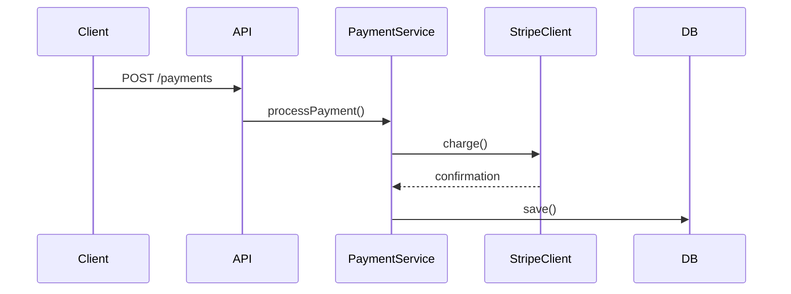
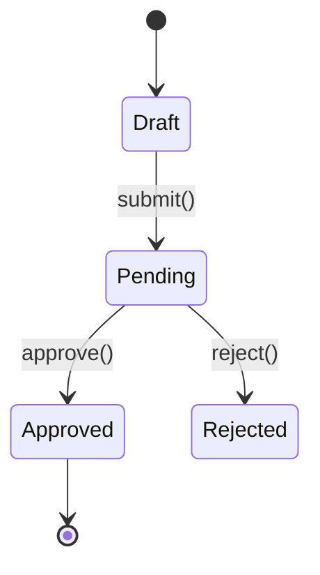

# Pull Request: Body Elements

## Diagrams

GitHub renders Mermaid natively in PR descriptions via ` ```mermaid ` code blocks. Include diagrams only when they add clarity prose can't — skip for trivial changes or obvious flows.

### Sequence Diagram

Include when the changes introduce or modify a clear runtime flow: API endpoints, event handlers, pipelines, multi-service interactions, webhook flows.

````markdown

````

### State Diagram

Include when the changes add or modify entity states, status enums, workflow transitions, or lifecycle hooks.

````markdown

````

### Text Sketch

Include when the point of the change is structural and a few lines show it faster than prose: where a call joined a call tree, how files or responsibilities were rearranged, where a component gained a child. Write an indented tree in a ` ```text ` block. When the surrounding shape already exists and the point is what was added or removed, write it in a ` ```diff ` block instead.

````markdown
```diff
 <entry point>
   <existing call>
+    <added call>
-  <removed call>
```
````

### Rules

- Keep diagrams focused — max ~10 nodes/transitions
- Use descriptive labels on arrows (method names, HTTP verbs)
- Place diagrams after the opening body text under a `## Flow` or `## State Machine` heading, and a text sketch beside the text it supports
- One diagram per type max, and combine types only when the PR truly has each pattern

## Merge Risk

Add a `## Merge Risk` section when merging is hard to undo or reaches past the surface the PR edits: a data migration or data deletion, a published interface or format, a change other consumers pick up without opting in. State in one or two lines what reverting the PR would not roll back, what else the change affects, or both, as applies. Place it last in the body. Omit the section for a change that a revert undoes and that stays within the surface it edits.

## Screenshots

Include screenshots when the PR adds a user-facing surface or changes how one looks, and this session already holds captures of that surface in its final state. Reuse those captures after viewing each one, keeping the fewest that show the change. A change in when an existing surface appears leaves its look unchanged, so add no capture of it. Take no new captures: with none on hand, add no screenshots.

Reference every kept capture in one row of a markdown table, with its caption in the header cell above it:

```markdown
| <caption> | <caption> |
| --- | --- |
|  |  |
```

### Rules

- Use markdown image syntax with the capture's absolute path. `gh` points only markdown references at the uploaded asset, so a raw `` tag keeps its local path.
- Reference every attached capture in the body. `gh` appends an attached file the body never references as its own paragraph.
- Place a new table after the opening body text under a `## Screenshots` heading, ahead of any `## Flow` or `## State Machine` section.

### Logical Width

Take a capture's scale factor as its pixels per logical pixel of the surface it shows: the device scale factor it was captured at, unless it was captured at logical scale or resized since. When that is unknown, use its recorded pixel density divided by 72 dpi, provided that density is a whole multiple of 72. Leave a capture whose scale factor cannot be established as uploaded.

To size an uploaded capture to its logical width, replace its markdown image in the posted body, which now points at its uploaded asset, with `" alt="<caption>" src="<asset URL>">`.

## Rules

- Don't reference `.turbo/` content (filenames, acceptance criteria, step numbers, headings) in the title or body. `.turbo/` is gitignored, so these references would be opaque to anyone reading without local copies.
