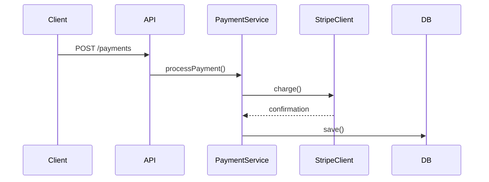
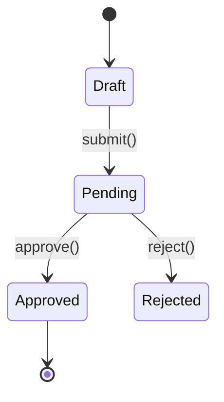

# Pull Request: Update

Read the current PR title and body, analyze what changed in the session, and draft an updated title and description that preserves the original writing style.

## Phase 1: Fetch Current PR

Fetch the details of the PR the router resolved:

```bash
gh pr view <PR_NUMBER> --json number,title,body,baseRefName,commits
```

## Phase 2: Analyze the Existing Style

Before drafting, study the current title and body to identify:

- **Title format** — length, prefix conventions (e.g., `feat:`, `fix:`), capitalization
- **Body structure** — headings, bullet points, sections, line length
- **Tone** — formal vs. casual, terse vs. detailed
- **Content patterns** — does it explain the "why", list changes, include test plans?
- **Diagrams** — does the body contain Mermaid code blocks (sequence, state, or other), or text sketches in `text` or `diff` blocks?
- **Merge risk** — does the body carry a Merge Risk section?
- **Screenshots** — does the body embed uploaded images?

## Phase 3: Evaluate Whether an Update Is Needed

Run `git fetch origin <base>` so the remote ref is current before any diff below. A local branch of the same name can sit behind the remote, which puts the merge base before an already-merged pull request and pulls merged work into the description.

Read the fetched body against the current diff and list what the body leaves undescribed:

```bash
git diff origin/<base>...HEAD
```

Check every Mermaid diagram and text sketch in the body the same way, node by node, transition by transition, and line by line. A diagram or sketch that omits a state or a node still renders, so only the code reveals its staleness.

If the body, its diagrams and text sketches, and any Merge Risk section already describe the diff, the diff warrants no Merge Risk section the body lacks, no embedded screenshot shows a look the PR has since reverted, and the session holds no final-state capture of an added or visually changed user-facing surface that the body lacks or shows in an older state, the description is up to date. Say so, then use the TaskList tool and proceed to any remaining task.

If what the body leaves undescribed is only trivial (formatting, typos, config-only), the body embeds no such screenshot, the diff warrants no Merge Risk section the body lacks, and the session holds no such capture, say so, then use the TaskList tool and proceed to any remaining task. Proceed when the body omits, misstates, or still describes behavior or merge risk the diff no longer contains.

## Phase 4: Analyze the Full Diff

Derive the PR description from the full diff, not from individual commits. The description should reflect the net change — what the code looks like now vs. the base — not the development journey. Intermediate bug fixes, reverted approaches, and implementation pivots that happened during development are not relevant to the reader.

1. Work from the full diff Phase 3 read (`git diff origin/<base>...HEAD`) — this is the primary source of truth
2. Use what Phase 3 found undescribed to understand what's new, but frame everything in the context of the whole PR
3. Check if the changes introduce runtime flows, state transitions, or structural changes that warrant diagrams (see Diagrams section below), and whether merging is hard to undo or reaches past the surface the PR edits (see Merge Risk section below)

## Phase 5: Run `/github-voice` Skill

Run the `/github-voice` skill to load writing style rules.

## Phase 6: Draft Updated Title and Description

Write an updated title and body that:

- **Matches the original style** — same structure, tone, formatting, and level of detail
- **Reflects the net change** — describe what the full diff shows, not the development history
- **Preserves what still applies** — keep existing text that remains accurate
- **Adds what's new** — integrate new changes naturally into the existing structure
- **Removes what's stale** — drop descriptions of work that was reverted or replaced
- **Scopes to the target repository** — write for someone who knows only the repository the PR targets; when the change is paired with work in another repository, name the interface the code calls and leave that repository's internal names, data shapes, and mechanisms out of the body; describe the change on its own terms, without reference to how a different repository or product does it
- **Updates diagrams** — if existing Mermaid diagrams or text sketches are present, update them to reflect the current state; if they describe reverted code, remove them; if new changes warrant diagrams, add them
- **Updates merge risk** — add, revise, or remove the Merge Risk section so it matches what the full diff now warrants
- **Updates screenshots** — leave the URL and any set width of each embedded image unaltered, removing an image only when the surface it shows is no longer part of the PR or the PR has since reverted the look it shows; add session captures as the Screenshots section directs, replacing an embedded screenshot only with a newer capture of the same surface

## Phase 7: Confirm with User

Output the drafted title and description as text, alongside the original for comparison, followed by the path of each capture that will upload, if any. After that, name each added surface or changed look that neither those captures nor an embedded screenshot shows in its final state, if any, with the reason it goes unshown. Then use `AskUserQuestion` for confirmation.

## Phase 8: Apply the Update

After confirmation, write the drafted title to `.turbo/pr/<PR_NUMBER>-title.txt` and the drafted body to `.turbo/pr/<PR_NUMBER>-body.md` with the Write tool, then update the PR. The title goes through a file because it carries text fetched from the PR, where backticks and `$` would run inside a quoted argument.

When the body references no capture by local path, update both in one command:

```bash
gh api --method PATCH "/repos/<owner>/<repo>/pulls/<PR_NUMBER>" \
  -f title="$(cat .turbo/pr/<PR_NUMBER>-title.txt)" \
  -F body=@.turbo/pr/<PR_NUMBER>-body.md
```

When it references captures by local path, send the title alone, then apply the body with one `--attach <path>` per capture, using the absolute path the body references:

```bash
gh api --method PATCH "/repos/<owner>/<repo>/pulls/<PR_NUMBER>" \
  -f title="$(cat .turbo/pr/<PR_NUMBER>-title.txt)"
gh pr edit <PR_NUMBER> --body-file .turbo/pr/<PR_NUMBER>-body.md --attach <path>
```

When `gh pr edit` reports a failed upload, act on what it printed, then report which captures the PR went without:

- **No PR URL** — nothing uploaded and the body was not applied. Remove each capture the body file references by local path, taking its table column with it and the table and its heading when no column remains. Then run `gh pr edit <PR_NUMBER> --body-file .turbo/pr/<PR_NUMBER>-body.md` without `--attach`.
- **A PR URL** — the body was applied, referencing the captures that did not upload by local path. Fetch the posted body with `gh pr view <PR_NUMBER> --json body --jq .body`, remove each table column whose image is still a local path, write the result to the body file, and apply it with the same command.

When a capture this run uploaded was taken at a scale factor above 1, size it to its logical width. Take the scale factor as the capture's pixels per logical pixel of the surface it shows: the device scale factor it was captured at, unless it was captured at logical scale or resized since. When that is unknown, use its recorded pixel density divided by 72 dpi, provided that density is a whole multiple of 72. Leave a capture whose scale factor cannot be established as uploaded. Fetch the posted body with `gh pr view <PR_NUMBER> --json body --jq .body`, replace each such capture's markdown image, which now points at its uploaded asset, with `" alt="<caption>" src="<asset URL>">`, write the result to the body file, and apply it with `gh pr edit <PR_NUMBER> --body-file .turbo/pr/<PR_NUMBER>-body.md`.

Then use the TaskList tool and proceed to any remaining task.

## Diagrams

GitHub renders Mermaid natively in PR descriptions via ` ```mermaid ` code blocks. Include diagrams only when they add clarity prose can't.

### Sequence Diagram

Include when the changes introduce or modify a clear runtime flow: API endpoints, event handlers, pipelines, multi-service interactions, webhook flows.

````markdown

````

### State Diagram

Include when the changes add or modify entity states, status enums, workflow transitions, or lifecycle hooks.

````markdown

````

### Text Sketch

Include when the point of the change is structural and a few lines show it faster than prose: where a call joined a call tree, how files or responsibilities were rearranged, where a component gained a child. Write an indented tree in a ` ```text ` block. When the surrounding shape already exists and the point is what was added or removed, write it in a ` ```diff ` block instead.

````markdown
```diff
 <entry point>
   <existing call>
+    <added call>
-  <removed call>
```
````

### Rules

- Keep diagrams focused — max ~10 nodes/transitions
- Use descriptive labels on arrows (method names, HTTP verbs)
- Place diagrams after the summary paragraph under a `## Flow` or `## State Machine` heading, and a text sketch beside the text it supports
- One diagram per type max, and combine types only when the PR truly has each pattern

## Merge Risk

Add a `## Merge Risk` section when merging is hard to undo or reaches past the surface the PR edits: a data migration or data deletion, a published interface or format, a change other consumers pick up without opting in. State in one or two lines what reverting the PR would not roll back, what else the change affects, or both, as applies. Place it last in the body. Omit the section for a change that a revert undoes and that stays within the surface it edits.

## Screenshots

Include screenshots when the PR adds a user-facing surface or changes how one looks, and this session already holds captures of that surface in its final state. Reuse those captures after viewing each one, keeping the fewest that show the change. A change in when an existing surface appears leaves its look unchanged, so add no capture of it. Take no new captures: with none on hand, leave the body's screenshots as they are.

Reference every kept capture in one row of a markdown table, with its caption in the header cell above it:

```markdown
| <caption> | <caption> |
| --- | --- |
|  |  |
```

When the body already embeds screenshots, keep their layout: a replacement capture takes the old image's place, and an added capture goes beside the existing ones.

### Rules

- Use markdown image syntax with the capture's absolute path. `gh` points only markdown references at the uploaded asset, so a raw `` tag keeps its local path.
- Reference every attached capture in the body. `gh` appends an attached file the body never references as its own paragraph.
- Place a new table after the summary paragraph under a `## Screenshots` heading, ahead of any `## Flow` or `## State Machine` section.

## Rules

- If the existing body is empty or minimal, infer a style from the title and commit messages
- Keep titles under 72 characters
- Preserve any existing sections the user clearly cares about (test plans, checklists, links)
- Don't reference `.turbo/` content (filenames, acceptance criteria, step numbers, headings) in the title or body. `.turbo/` is gitignored, so these references would be opaque to anyone reading without local copies.
