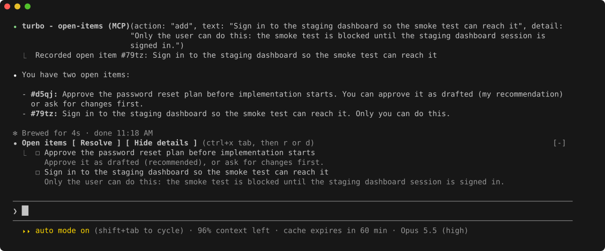
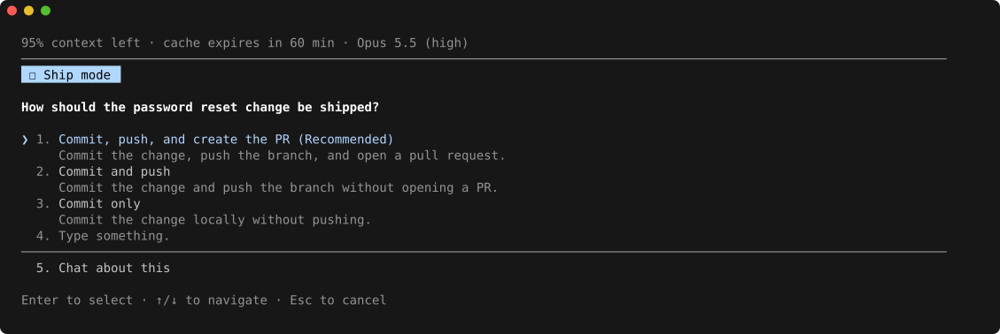
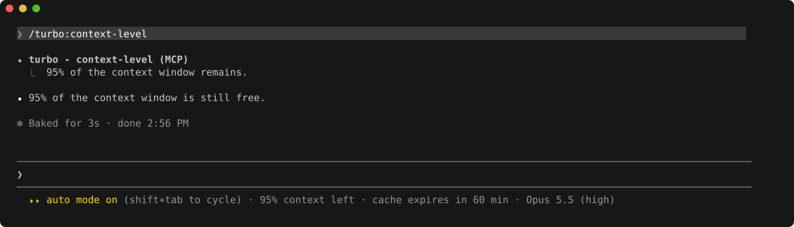
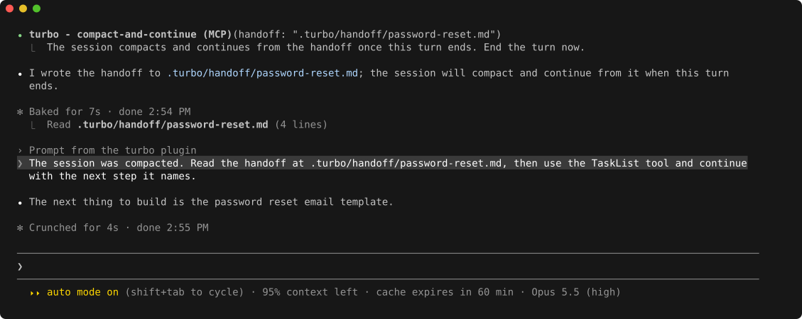

# Claude Code Mod

[← Back to Turbo](../README.md) · [Workflow guide](workflows.md) · [Prompt examples](examples.md) · [Requirements](requirements.md) · [Customization](customization.md)

The Claude Code plugin ships a [mod](https://claude.com/blog/claude-code-mods) alongside its skills. It keeps you informed while a pipeline runs, and it keeps long pipelines going when the context window fills up. The Codex edition loads the same rules through a `SessionStart` hook and has none of the rest.

## Open Items

Whenever a turn ends with something only you can decide or do, such as a plan to approve or a sign-in to complete, Claude records it through the `turbo - open-items` tool. Open items are listed in the band above the prompt.

The band keeps those items in view after the reply that raised them scrolls away. Click **Resolve** to run [`/turbo:resolve-open-items`](../claude/skills/resolve-open-items/SKILL.md), which walks each item through a question with the recommendation first. From the keyboard, press `ctrl+x tab` to focus the band, then `r`. You can also settle an item in your own words, and Claude resolves it from your reply. A resolved item shows struck through for a moment before it disappears.

The list survives compaction. `/clear` and `/resume` start it empty. Before a `/clear`, run [`/turbo:handoff`](../claude/skills/handoff/SKILL.md) to carry the items into the handoff.

## Status Line

The line under the prompt shows how much of the context window is left, when the prompt cache expires, and which model and effort level answered the last turn. Once the cache expires, the next turn re-reads the whole conversation at full price, so the countdown tells you when stepping away gets costly. It learns whether your session caches for five minutes or an hour. While Claude works, the countdown drops out.

The same reading also appears above every `AskUserQuestion` dialog, where a skill waits on your answer:

## Context Level

Skills read how much context is left through the `turbo - context-level` tool. [`/refine-plan`](../claude/skills/refine-plan/SKILL.md) and [`/polish-code`](../claude/skills/polish-code/SKILL.md) check it before each decision on another iteration, and [`/implement`](../claude/skills/implement/SKILL.md) checks it once before QA. [`/implement-plan`](../claude/skills/implement-plan/SKILL.md) uses it to project whether reading the plan's files fits the window. [`/turbo:context-level`](../claude/skills/context-level/SKILL.md) gives you the same reading on request:

## Compaction That Continues

When one of those checks finds context running low, the skill asks whether to write a handoff and compact. When you agree, [`/handoff`](../claude/skills/handoff/SKILL.md) saves the session's state to a file, and the `turbo - compact-and-continue` tool tells the mod to compact once the turn ends. After compacting, the mod sends a prompt that has Claude read the handoff and pick up the next step, so the pipeline continues without you retyping anything:

If you ask Claude to compact during a pipeline, its next check takes the same path without asking. If compaction is skipped or fails, a notice asks you to run `/compact` and reply "continue".

## Rules and Startup Checks

The mod injects [Turbo's rules](../claude/ADDITIONS.md) into every session and into the subagents Claude spawns, so skills load and gates hold the same way everywhere. [Harness Instructions](customization.md#harness-instructions) covers why the rules exist.

At startup the mod also checks your setup and shows a notice for what to fix. Claude passes the notice on to you as well:

- **`CLAUDE_CODE_ENABLE_TODO_TOOLS` not set**: Turbo's step tracking stays off until you [enable the task tracking tools](../claude/SETUP.md#step-4-enable-task-tracking-tools).
- **An earlier copy install is still present**: run `/update-turbo` once to move to the plugin.
