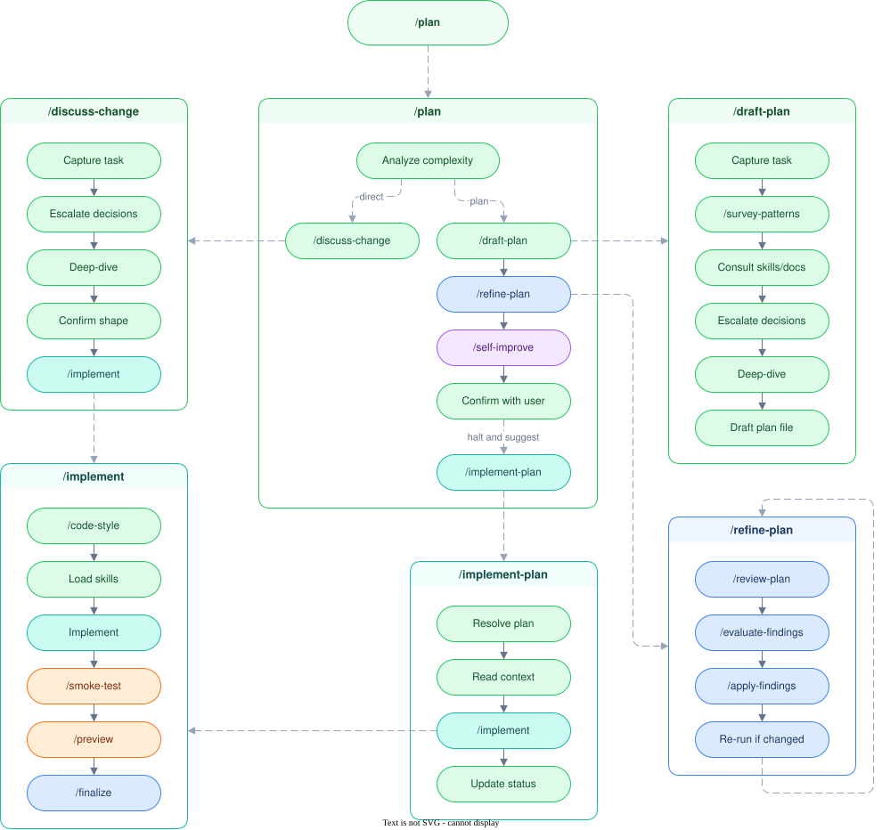
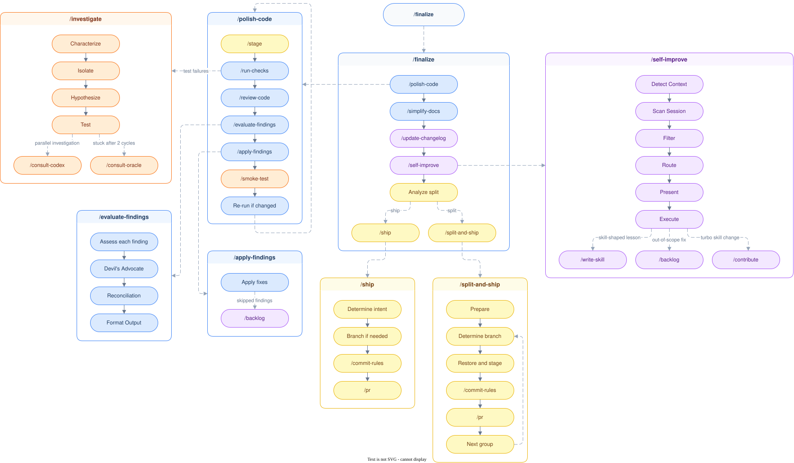

# Workflows

[← Back to Turbo](../README.md) · [Prompt examples](examples.md) · [Requirements](requirements.md) · [Claude Code mod](claude-code-mod.md) · [Customization](customization.md)

Turbo runs a change through the six stages of a human-gated software factory, mapped to their skills in the [README](../README.md#the-factory). This guide follows a change through those stages from your side first: what happens, and where you step in. Then it opens up the pipelines that carry a change through several stages in one run. Skills appear here as `/<skill-name>`. In Claude Code you type one as `/turbo:<skill-name>`, and in Codex as `$turbo:<skill-name>`. Each edition’s skill index ([Claude Code](../claude/SKILL-INDEX.md), [Codex](../codex/SKILL-INDEX.md)) links to its implementation.

## The Stages

In Claude Code, anything a stage leaves for you to decide or do stays listed [above the prompt](claude-code-mod.md#open-items) until you settle it. Long planning and polish loops, and the step before QA, check how much context is left and offer to [compact and continue](claude-code-mod.md#compaction-that-continues) when it runs low.

### Shape

You start with the change you want, typed after `/turbo:plan`. It weighs the change's scope, stakes, and unknowns, recommends a mode, and lets you set the route: a short interview for a clear-scope change, or a written plan when the approach needs surveying and review. Either way, nothing gets built until you approve the agreed shape or the plan. When a question turns on how something looks or feels, [`/prototype`](../claude/skills/prototype/SKILL.md) builds a page you can try before you answer. [The Plan Pipeline](#the-plan-pipeline) covers both modes.

### Build

The agreed change gets made. [`/implement`](../claude/skills/implement/SKILL.md) loads [`/code-style`](../claude/skills/code-style/SKILL.md) plus any skills that match the work, applies the change, runs the checks a plan names, and smoke tests a user-facing change in the live app. A plan file is built by [`/implement-plan`](../claude/skills/implement-plan/SKILL.md) in a fresh session.

In the Claude Code edition, `/implement-plan` projects how much of the context window reading the plan's files will take before it reads most of them. Above a quarter of the window it shows you the figure and asks how to implement: in this session, which then likely needs a compaction before QA, or through one fresh subagent per plan step, each checked by the session before the next one starts.

### Try

You judge a user-facing change firsthand. [`/preview`](../claude/skills/preview/SKILL.md) stands up the live app, lists the scenarios worth trying, and ends its turn so you can try it at your own pace. Reply that it looks good, or describe what needs changing. `/implement` runs it automatically before closing out a user-facing change, once `/smoke-test` has driven the flow and cleared what it could. [Browser and UI Testing](#browser-and-ui-testing) covers the testing skills behind it.

### Polish

[`/polish-code`](../claude/skills/polish-code/SKILL.md) checks and reviews the change until it holds still. It formats, lints, and tests, then reviews the change with internal reviewers and the other coding agent as an independent peer reviewer. It weighs each finding, applies what survives, and re-runs. In Claude Code, it stops after the third iteration that still changed something to ask whether another round is worth it. For changes that don't warrant the deep loop, [`/quick-finalize`](../claude/skills/quick-finalize/SKILL.md) runs the project's checks once and closes out.

### Learn

[`/self-improve`](../claude/skills/self-improve/SKILL.md) carries what the session taught into the places future sessions read: project instructions, auto memory, and skills. Ideas that fall outside the change go to the backlog instead. [Self-Improvement](#self-improvement) covers both.

### Ship

[`/ship`](../claude/skills/ship/SKILL.md) asks how the change should land and commits only once you choose. Then it pushes and creates or updates the pull request through [`/pr`](../claude/skills/pr/SKILL.md). When a changeset holds several unrelated changes, [`/split-and-ship`](../claude/skills/split-and-ship/SKILL.md) ships each group as its own branch and pull request, or as sequential commits.

## The Pipelines

### The Plan Pipeline

`/plan` covers Shape. In direct mode it carries the change on through Build and Try, then offers the close-out.

Claude Code's built-in plan mode tends to produce plans that miss existing patterns, skip edge cases, or propose approaches that don't hold up under scrutiny, and it can feel too restrictive for iterative planning. Turbo replaces it with [`/plan`](../claude/skills/plan/SKILL.md) as a universal entry point: whatever the size of the task, you start there by typing `/turbo:plan`. It analyzes the task, routes it through the right pipeline, and produces plans that survive contact with reality, with no need for plan mode to be active. Direct work chains through [`/discuss-change`](../claude/skills/discuss-change/SKILL.md) and [`/implement`](../claude/skills/implement/SKILL.md) to [`/finalize`](../claude/skills/finalize/SKILL.md); plan-mode work halts once for a fresh [`/implement-plan`](../claude/skills/implement-plan/SKILL.md) session.

[`/plan`](../claude/skills/plan/SKILL.md) has two modes, named by what each one produces. Its complexity analysis recommends a mode, then you confirm the route:

- **Direct mode** — Clear scope, with any remaining decisions small enough to settle in conversation. Hands off to [`/discuss-change`](../claude/skills/discuss-change/SKILL.md), which escalates open product decisions, agrees the implementation shape with you, then runs [`/implement`](../claude/skills/implement/SKILL.md), which loads [`/code-style`](../claude/skills/code-style/SKILL.md) plus any task-specific skills, applies the change, smoke tests any UI/UX change and previews it for you to try, and offers [`/finalize`](../claude/skills/finalize/SKILL.md), a quick close, or stopping. No plan file is written.
- **Plan mode** — The approach warrants writing down before implementing, however large the work turns out to be. Runs [`/draft-plan`](../claude/skills/draft-plan/SKILL.md) (survey + consult skills/docs + escalate + discuss + draft) → [`/refine-plan`](../claude/skills/refine-plan/SKILL.md) → [`/self-improve`](../claude/skills/self-improve/SKILL.md), then asks whether to commit any repository files the lessons changed. Halts after that; you run [`/implement-plan`](../claude/skills/implement-plan/SKILL.md) in a fresh session.

A plan states the deployment's bounds and, where the change has observable behavior, its acceptance criteria alongside the implementation steps. That gives [`/review-plan`](../claude/skills/review-plan/SKILL.md) something concrete to judge proportionality against, so it can tell machinery the system needs from machinery it doesn't. [`/draft-plan`](../claude/skills/draft-plan/SKILL.md) also takes a background document — a design doc, an issue, a written proposal — and treats decisions that document already settles as answered, while still confirming the deployment's bounds with you.

Both modes offer [`/prototype`](../claude/skills/prototype/SKILL.md) when a discussion question turns on how a surface looks or whether an interaction reads the way you expect. It builds a self-contained page under `.turbo/prototypes/`, drives every control itself, and hands you the file, ending its turn so you can try it at your own pace. Reply that it settled your questions, or describe what to change. The decisions that follow then rest on something you've used instead of on faith. [`/draft-plan`](../claude/skills/draft-plan/SKILL.md) and [`/discuss-change`](../claude/skills/discuss-change/SKILL.md) also end their turn on the summary they present for approval. Reply to approve it, describe what to change, or ask to prototype an unknown you only spot while reading it.

Every sub-skill works standalone too. Run [`/draft-plan`](../claude/skills/draft-plan/SKILL.md) directly if you want to draft a plan without the rest of the pipeline. Run [`/refine-plan`](../claude/skills/refine-plan/SKILL.md) on a plan you wrote yourself. Run [`/implement-plan`](../claude/skills/implement-plan/SKILL.md) in a fresh session on any plan file.

### The Finalize Pipeline

`/finalize` covers Polish, Learn, and Ship in one run.

[`/finalize`](../claude/skills/finalize/SKILL.md) is the QA and commit side of the loop. Run it when you're done implementing, or let [`/implement`](../claude/skills/implement/SKILL.md) / [`/implement-plan`](../claude/skills/implement-plan/SKILL.md) chain into it automatically once a plan file's steps are done. Without a plan file, `/implement` asks first, offering [`/quick-finalize`](../claude/skills/quick-finalize/SKILL.md) as a quick close or stopping instead. One command runs tests, iterative code polishing, documentation cleanup, changelog updates, self-improvement, and commit.

`/finalize` runs through these phases automatically:

1. **Polish Code** — Iterative loop: stage → format → lint → test → review → evaluate → apply → smoke test → re-run until stable
2. **Simplify Docs** — Strip unnecessary comments and documentation noise from the changed files
3. **Update Changelog** — Add entries to the Unreleased section of CHANGELOG.md (skipped if no changelog exists)
4. **Self-Improve** — Extract learnings, route to CLAUDE.md / AGENTS.md / memory / skills
5. **Ship It** — Branch if needed, commit, update an existing PR, push, then create a PR if none exists and link the changelog entries written before it

[`/quick-finalize`](../claude/skills/quick-finalize/SKILL.md) is the sibling for changes that don't warrant the deep review loop. It stages, simplifies code and docs, runs the project's checks via [`/run-checks`](../claude/skills/run-checks/SKILL.md), smoke tests, updates the changelog, self-improves, and ships. Same close-out, without the iterative bug hunt.

## Self-Improvement

[`/self-improve`](../claude/skills/self-improve/SKILL.md) makes each session teach the next. Run it anytime before ending your session (it's also part of [`/finalize`](../claude/skills/finalize/SKILL.md) Phase 4). It scans the conversation for corrections, repeated guidance, failure modes, and preferences, then routes each lesson to the right place: project `CLAUDE.md`/`AGENTS.md`, auto memory, or existing/new skills. A rule for your code that a tool could enforce becomes a backlog item to build that check. Ask it to distill past sessions and it sweeps the project's earlier transcripts instead, skipping what a previous run already covered and treating guidance repeated across sessions as a documentation gap rather than one-off steering. Over time, Turbo gets better at your specific project.

Memory notes pile up, and some go stale. In the Claude Code edition, [`/dream`](../claude/skills/dream/SKILL.md) consolidates the project's auto memory when you ask: it checks notes against the code, merges duplicates, corrects or removes what the evidence contradicts, and tidies the index. It prints each note's original text before changing it. Then it lists what finished work left behind in `.turbo/` and asks what to delete.

[`/backlog`](../claude/skills/backlog/SKILL.md) captures improvement opportunities that surface during work but fall out of scope: review findings you skipped, refactoring ideas, missing tests, and deliberate simplifications that accept a known ceiling. They're tracked in `.turbo/backlog.md` (gitignored, so they don't clutter the repo), each tagged `direct`, `investigate`, or `plan` for later routing.

Backlogs collect entries that turn out not to matter. [`/triage-backlog`](../claude/skills/triage-backlog/SKILL.md) walks through them with you: it merges duplicates, states the user story or the simplification behind each entry, and asks whether to keep or drop it.

When you're ready to act, [`/implement-backlog`](../claude/skills/implement-backlog/SKILL.md) validates each entry against the current codebase, drops stale ones, and runs one lane per session:

- **`direct`** → [`/implement`](../claude/skills/implement/SKILL.md) for a clear-scope fix
- **`investigate`** → [`/investigate`](../claude/skills/investigate/SKILL.md), then [`/implement`](../claude/skills/implement/SKILL.md)
- **`plan`** → [`/plan`](../claude/skills/plan/SKILL.md)

## Browser and UI Testing

[`/smoke-test`](../claude/skills/smoke-test/SKILL.md) and [`/exploratory-test`](../claude/skills/exploratory-test/SKILL.md) (Claude) / [`$smoke-test`](../codex/skills/smoke-test/SKILL.md) and [`$exploratory-test`](../codex/skills/exploratory-test/SKILL.md) (Codex) automate manual testing — the kind of hands-on verification you'd normally do yourself. See [Browser and UI Testing Tools](requirements.md#browser-and-ui-testing-tools) for what drives them in each edition. [`/preview`](../claude/skills/preview/SKILL.md) / [`$preview`](../codex/skills/preview/SKILL.md) is the hand-over for the [Try](#try) stage, and you can run it standalone any time you want to poke at the running app.
